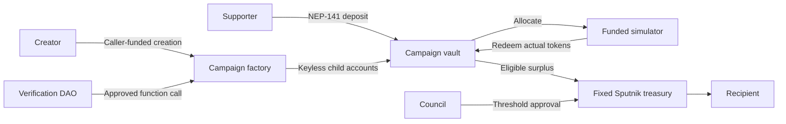

# YieldFund on NEAR

**Community fundraising through eligible yield donations.** Supporters allocate tokens to a campaign vault. Realized eligible surplus funds its fixed DAO treasury; the DAO approves community payments. Supporters retain a claim on recoverable capital. Capital can lose value, and withdrawals can be delayed.

[Live testnet app](https://yieldfund-eosin.vercel.app/) · [Source repository](https://github.com/usamahabduljalil/YieldFund).

Built for NEAR HACKATHON. The landing page is wallet-free; connection, positions, treasury proposals, receipts and operation controls live in `/app`.

## Current release

Last reviewed: **13 November 2026**. This is an experimental hackathon implementation, not an audited mainnet product. The hosted build uses existing testnet contracts in **read-only mode**. Local preview balances are explicitly fictional. The funded simulator uses actual test tokens and is **not Rhea yield**.

The approved public testnet lifecycle completed eleven transactions: **30 tUSD donated, 20 paid by the DAO, 200 withdrawn, 800 tUSD backing 800 remaining units**. See [transaction evidence](docs/evidence/milestone-9-execution-notes.md) and [browser reconciliation](docs/evidence/milestone-11-browser-reconciliation.md).

| Capability                                | Implementation and evidence                                                                                                                        |
| ----------------------------------------- | -------------------------------------------------------------------------------------------------------------------------------------------------- |
| Landing and application UI                | Implemented; reference palette, fonts, responsive layouts and concise copy                                                                         |
| Deposits, allocation and withdrawals      | Local real-Wasm tests and finalized public testnet lifecycle                                                                                       |
| Funded profit, settlement, loss and delay | Actual test-token simulator; profit lifecycle on testnet, loss/delay in Sandbox                                                                    |
| Sputnik DAO payments                      | Pinned upstream contract; three council members, two approvals; testnet payment completed                                                          |
| Wallet and receipt tracking               | Account-bound reviews, exact call/receipt checks and persistent recovery; CLI handoffs exercised; live rejection/switch acceptance remains partial |
| Permissionless campaigns                  | Factory and real Sandbox two-campaign/DAO lifecycle verified. Network-scoped discovery and unsigned draft reviews implemented; signed creation/selection and public factory deployment remain pending                       |
| DAO verification                          | DAO-only expiring attestations, immutable metadata binding and revocation. A badge is not a safety or return guarantee                             |
| Mainnet                                   | Read-only protocol/Rhea discovery and network-bound wallet adapter tests. Public mainnet transactions, adapter deployment and lifecycle verification pending                                      |
| Rhea real yield                           | Mainnet state read successfully; supply/redemption adapter and funded lifecycle proof incomplete                                                   |
| Trezu                                     | Source/interoperability investigation; actual discovery/proposal/payment rehearsal incomplete                                                      |
| Callback recovery                         | Balance-read restart and proven simulator redemption supported. Unknown outgoing transfers/allocation and some callback failures remain locked     |

The user selected **DAO approval** for verification and authorized GitHub/Vercel publication. Mainnet has a **5 NEAR total cap**. The supplied account was absent at the observed block, and the current deployment architecture exceeds the cap before gas. No mainnet spending or signatures have occurred. [Read-only discovery evidence](docs/evidence/mainnet-discovery.json).

## Run locally

Requirements: Node **22.x (22.14+)**, npm and Git. Run commands from the repository root.

```sh
npm ci
npm run dev
```

Open `http://127.0.0.1:4173/`, then Launch app. Default preview scenarios are fictional and stored in the browser. Connecting a wallet does not turn preview into a chain deployment.

For public testnet reads:

```sh
npm run dev:testnet
```

Open `http://127.0.0.1:4175/app`. Public reads need no wallet. This session allows account selection and disables signing. No key or seed phrase is requested. [Frontend configuration](docs/contracts/frontend-chain.md).

## Architecture



Accounting uses integer token base units. Deposits create nominal units; withdrawals receive proportional recoverable value after reconciliation. Unsolicited tokens are excluded from eligible yield. Allocation creates no new units. A successful outer transaction alone does not prove nested payments succeeded.

The vault journals asynchronous operations and checks authenticated callback stage/version. Unknown outcomes remain locked instead of blindly retrying payments. See [custody rules](contracts/README.md), [strategy/DAO API](docs/contracts/strategy-and-dao.md) and [recovery boundaries](docs/contracts/recovery.md).

Factory campaigns bind token, beneficiary, metadata and strategy immutably. Each creator funds deployment; vault/strategy children have no access keys. Campaigns start unverified and become ready only after deployment and token registration. The configured verification DAO approves an expiring attestation for the exact metadata hash. Initial templates deploy the funded simulator, not real lending. Partial creation recovery remains a limitation.

## Repository map

| Path                                               | Purpose                                                               |
| -------------------------------------------------- | --------------------------------------------------------------------- |
| `apps/web`                                         | React/TypeScript/Vite UI, HOT Connect, reads and transaction reviews  |
| `packages/domain`                                  | Integer accounting and operation reference model                      |
| `packages/near-client`                             | Deployment validation, read transport, unsigned calls, receipt checks |
| `contracts/campaign-vault`                         | Custody, positions, reconciliation, withdrawals and donations         |
| `contracts/strategy-simulator`                     | Token-funded simulation; separate loss/delay test artifact            |
| `contracts/campaign-factory`                       | Permissionless creation and DAO-owned attestations                    |
| `contracts/accounting`, `contracts/test-token`     | Shared math and fixed-supply test token                               |
| `tests/integration`                                | Real Wasm, token receipts and Sputnik governance in Sandbox           |
| `tests/fixtures/reviewed-testnet`                  | Exact historical reviewed binaries, separate from new builds          |
| `deployments`, `docs/evidence`                     | Public configuration, reviewed plans, receipts and screenshots        |
| `agent.md`                                         | Actual progress, decisions, unresolved issues and next task           |
| `IMPLEMENTATION_PLAN.md`, `docs/EXPANSION_PLAN.md` | Acceptance criteria and expanded scope                                |

## Verify changes

```sh
npm test
npm run build
npm run test:sites
npm run build:host
```

Current TypeScript suite: **146 passing, one optional local-Sandbox skip**. Production build includes type checking; four Sites packaging checks pass. GitHub run [43396632842](https://github.com/usamahabduljalil/YieldFund/actions/runs/43396632842) passed both web and contract jobs for `c282f40`; later revisions require their own checks. Contract regression: 32 units and 14 Sandbox scenarios passed, one fixture generator ignored.

For contracts, use Linux/Ubuntu WSL with Rust **1.95.0**, `wasm32-unknown-unknown`, a C/C++ toolchain, CMake and OpenSSL build dependencies:

```sh
bash scripts/test-contracts.sh
cargo fmt --all -- --check
```

This builds normal and fault-only artifacts and the factory, verifies/copies the exact reviewed Sputnik binary, then runs unit and Sandbox tests. The source rebuild is separate: `bash scripts/build-dao.sh` pins the upstream archive and rejects a different output hash. The first GitHub runner rebuild produced a different hash; byte-for-byte cross-machine reproducibility remains unresolved. Integration tests use the exact deployed historical binary and do not substitute that differing rebuild. Factory builds follow templates because they embed vault/strategy Wasm. For only normal templates and factory:

```sh
bash scripts/build-factory.sh
cargo test --locked -p yieldfund-campaign-factory --lib
```

Sandbox **2.14.0** needs a compatible Linux runtime. CI uses Ubuntu 24.04; isolated Ubuntu 22.04 compatibility is documented in [contract setup](contracts/README.md). Keep fault/control artifacts in local tests.

Historical deployment tests use hash-checked fixtures instead of newly rebuilt contracts. Optional fixture refresh fails if public code differs from reviewed hashes:

```sh
node --experimental-strip-types scripts/fetch-reviewed-artifacts.mjs
```

## Public contracts and hosting

Existing **testnet only**:

| Role            | Account                               |
| --------------- | ------------------------------------- |
| Vault           | `vault.yf-operator-261105.testnet`    |
| Token           | `token.yf-operator-261105.testnet`    |
| Simulator       | `strategy.yf-operator-261105.testnet` |
| Beneficiary DAO | `dao.yf-operator-261105.testnet`      |

`deployments/testnet.json` pins configuration, policy and code hashes. The old eleven-call approval is exhausted; do not replay it. Retained full-access keys can replace code, and rehearsal actors share local custody. No state migration is supplied.

`vercel.json` configures install `npm ci`, build `npm run build:host`, output `apps/web/dist/client`. Hosting preparation writes only the read-only public testnet manifest into build output; local preview remains unchanged. SPA rewrites cover `/app/*` and `/risks`. Missing assets/API paths do not become the app shell. No private keys, backend signer or secret environment variables are needed.

The Vercel project is currently deployed manually from exact GitHub commit SHAs through the authenticated API; automatic Git-triggered deployment is not connected. See [release evidence](docs/evidence/milestone-14-public-release.md).

`apps/web/public/registry.json` contains an empty `deployments` list until a factory and verification DAO have been deployed and their configuration/code hashes reviewed. `/app/campaigns` supports paginated, network-scoped discovery; `/app/campaigns/new` offers metadata drafts. Draft downloads are explicitly unsigned and do not create campaigns. Browsing mainnet does not switch the existing testnet wallet.

`.github/workflows/verify.yml` runs web and contract checks. Publishing the frontend is separate from deploying contracts or enabling transactions. Verify the exact commit, logs, deep routes, manifest and wallet behavior before describing a release as ready.

## Remaining integration work

1. Finish signed campaign creation, campaign selection and DAO verification proposal UI; exercise wallet handoffs with a reviewed factory deployment. Discovery and downloadable unsigned drafts are implemented.
2. Integrate the network-bound wallet adapter into a verified mainnet deployment and apply token metadata/precision across every review/display. Adapter unit tests alone do not prove mainnet wallet acceptance.
3. Implement Rhea supply-only handling, liquidity delays and redemption evidence. An execute response alone cannot establish completed FT delivery. Verify actual supply, realized redemption and eligible donation with finalized receipts.
4. Verify the same beneficiary DAO in Trezu: discovery, policy/token display, proposal, threshold execution and recipient balance.
5. Resolve partial factory creation and unknown outgoing-operation recovery before unrestricted deposits.
6. Fund the mainnet account and settle a deployment approach/budget within the approved cap before preparing calls. Never substitute simulated profit for real yield evidence.

References: [official Rhea lending SDK](https://github.com/rhea-finance/lending-sdk-golang), [official Trezu source](https://github.com/NEAR-DevHub/trezu). Research/public reads are not lifecycle verification.

## Keep this README current

After meaningful changes, update the date, capability table, exact test counts and remaining work. Link new evidence while preserving historical results. Update `agent.md` in the same change. Add verified repository/demo URLs and deployment commit when publishing. Never mark an integration complete from a mock, source inspection or top-level success alone.

Original hackathon brief and specification are preserved. The [demo walkthrough](docs/DEMO_WALKTHROUGH.md) is prepared; recording, the human's demo post and exact-payload hackathon submission are separate tasks.

## Attribution and licensing

Sputnik DAO is reused from `near-daos/sputnik-dao-contract` commit `5434a59dec23ee0c49df8c8c4350c208a7e75b0b`, under its [MIT license](tests/fixtures/reviewed-testnet/LICENSE-Sputnik). NEAR SDK/standards, HOT Connect, React, Vite, IBM Plex Mono and Phosphor retain their respective licenses. [Artwork provenance](docs/design/asset-notes.md).

No project-wide license has been selected for YieldFund's original code. Public repository access does not itself grant an additional software license.
