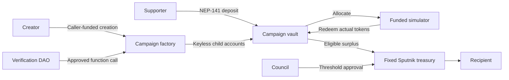

# YieldFund on NEAR

**Community fundraising through eligible yield donations.** Supporters allocate tokens to a campaign vault. Realized eligible surplus funds its fixed DAO treasury; the DAO approves community payments. Supporters retain a claim on recoverable capital. Capital can lose value, and withdrawals can be delayed.

[Live testnet app](https://yieldfund-eosin.vercel.app/) · [Source repository](https://github.com/usamahabduljalil/YieldFund).

Built for NEAR HACKATHON. The landing page is wallet-free; connection, positions, treasury proposals, receipts and operation controls live in `/app`.

## Try the demo in two minutes

1. [Launch the app](https://yieldfund-eosin.vercel.app/app): see The Commons' **800 tUSD backing, 800 units and 30 donated**. Public reads require no wallet.
2. Open **Campaigns**, then **Community Garden**: see a separate campaign and 1,000 tUSD cap. Reload the deep link to retain the selected campaign. **Builder Commons** has separate vault/strategy accounts. Garden's DAO attestation is distinct from Builders' unverified status.
3. Return to **The Commons → Treasury → proposal #0**: see **two council approvals**, **20 tUSD paid** and **10 remaining**.
4. Open **Activity → withdrawal operation #4**: inspect the completed **200 tUSD** withdrawal. Fresh browsers have no saved wallet history; contract operations remain readable.
5. Read [demo walkthrough](docs/DEMO_WALKTHROUGH.md) for a recording sequence and [manual submission kit](docs/MANUAL_SUBMISSION.md) for the human's final post/form checklist.

## Current release

Last reviewed: **17 November 2026**. This is an experimental hackathon implementation, not an audited mainnet product. The hosted build uses existing testnet contracts in **read-only mode**. Local preview balances are explicitly fictional. The funded simulator uses actual test tokens and is **not Rhea yield**.

Post-deadline integration work: a separate **direct Rhea vault build** now uses standard NEP-141 supply and payouts plus Rhea's `simple_withdraw` finalizer. Two local Sandbox lifecycles passed against code downloaded from Rhea's actual mainnet deployment: supply/redemption/supporter exit, and borrower-generated interest → donation → two-vote DAO payment. Unsolicited gifts stay excluded. **This is local compatibility evidence, not a mainnet deposit or earned mainnet yield.** Trezu verification/revocation/settlement templates pass Trezu's pinned schema; installation and an actual Trezu proposal/payment are still pending. See [integration details and reproduction](docs/contracts/rhea-and-trezu.md).

The approved public testnet lifecycle completed eleven transactions: **30 tUSD donated, 20 paid by the DAO, 200 withdrawn, 800 tUSD backing 800 remaining units**. See [transaction evidence](docs/evidence/milestone-9-execution-notes.md) and [browser reconciliation](docs/evidence/milestone-11-browser-reconciliation.md).

| Capability                                | Implementation and evidence                                                                                                                        |
| ----------------------------------------- | -------------------------------------------------------------------------------------------------------------------------------------------------- |
| Landing and application UI                | Implemented; reference palette, fonts, responsive layouts and concise copy                                                                         |
| Deposits, allocation and withdrawals      | Local real-Wasm tests and finalized public testnet lifecycle                                                                                       |
| Funded profit, settlement, loss and delay | Actual test-token simulator; profit lifecycle on testnet, loss/delay in Sandbox                                                                    |
| Sputnik DAO payments                      | Pinned upstream contract; three council members, two approvals; testnet payment completed                                                          |
| Wallet and receipt tracking               | Account-bound reviews, exact call/receipt checks and persistent recovery; CLI handoffs exercised; live rejection/switch acceptance remains partial |
| Permissionless campaigns                  | Factory deployed on testnet; two creators produced isolated keyless vault/strategy pairs. Selected-campaign runtime, wallet-bound creation review and persistent receipt recovery implemented; v2 recovery is implemented and locally tested; hosted signing awaits fresh deployment and browser transaction acceptance |
| DAO verification                          | DAO-only expiring attestations, immutable metadata binding and revocation. A badge is not a safety or return guarantee                             |
| Mainnet                                   | Explicit Rhea runtime, protocol snapshots, 0–24 decimal token UI and network-bound wallet dispatch implemented. Mainnet signing, deployment and lifecycle verification pending                                      |
| Rhea real yield                           | Direct vault adapter implemented; actual deployed Rhea binary and standard-token lifecycle tested locally. Funded mainnet lifecycle still pending |
| Trezu                                     | Verification/revocation/settlement template exporter checks actual DAO authority; manifests pass upstream schema. Live Trezu import/proposal/payment pending |
| Callback recovery                         | V2 source adds evidence-based payment/allocation/simulator recovery and resumable factory setup. Verified locally; historical deployed contracts retain their old limits     |

The user selected **DAO approval** for verification and authorized GitHub/Vercel publication. Real Rhea/Trezu implementation resumed on November 17. The earlier mainnet deployment deferral still applies to spending: no mainnet signatures or transfers have occurred. A funded operator and treasury plus a concrete deployment review are required for live acceptance. The replacement operator exists but its checked balance is below vault code-storage requirements; the supplied Trezu ID is a passkey wallet, so the treasury DAO still needs to be identified. [Earlier read-only discovery evidence](docs/evidence/mainnet-discovery.json).

## Run locally

Requirements: Node **22.x (22.14+)**, npm and Git. Run commands from the repository root.

```sh
npm ci
npm run dev
```

Open `http://127.0.0.1:4173/`, then Launch app. Default preview scenarios are fictional and stored in the browser. Connecting a wallet does not turn preview into a chain deployment.

For public testnet reads:

```sh
npm run dev:testnet
```

Open `http://127.0.0.1:4175/app`. Public reads need no wallet. This session allows account selection and disables signing. No key or seed phrase is requested. [Frontend configuration](docs/contracts/frontend-chain.md).

## Architecture



Accounting uses integer token base units. Deposits create nominal units; withdrawals receive proportional recoverable value after reconciliation. Unsolicited tokens are excluded from eligible yield. Allocation creates no new units. A successful outer transaction alone does not prove nested payments succeeded.

The vault journals asynchronous operations and checks authenticated callback stage/version. Unknown outcomes remain locked instead of blindly retrying payments. See [custody rules](contracts/README.md), [strategy/DAO API](docs/contracts/strategy-and-dao.md) and [recovery boundaries](docs/contracts/recovery.md).

Factory campaigns bind token, beneficiary, metadata and strategy immutably. Each creator funds deployment; vault/strategy children have no access keys. Campaigns start unverified and become ready only after deployment and token registration. The configured verification DAO approves an expiring attestation for the exact metadata hash. Initial templates deploy the funded simulator, not real lending. V2 source adds version-bound partial creation recovery with protected native reserves; the historical deployed factory still has its original limitation.

## Repository map

| Path                                               | Purpose                                                               |
| -------------------------------------------------- | --------------------------------------------------------------------- |
| `apps/web`                                         | React/TypeScript/Vite UI, HOT Connect, reads and transaction reviews  |
| `packages/domain`                                  | Integer accounting and operation reference model                      |
| `packages/near-client`                             | Deployment validation, read transport, unsigned calls, receipt checks |
| `contracts/campaign-vault`                         | Custody, positions, reconciliation, withdrawals and donations         |
| `contracts/strategy-simulator`                     | Token-funded simulation; separate loss/delay test artifact            |
| `contracts/campaign-factory`                       | Permissionless creation and DAO-owned attestations                    |
| `contracts/accounting`, `contracts/test-token`     | Shared math and fixed-supply test token                               |
| `tests/integration`                                | Real Wasm, token receipts and Sputnik governance in Sandbox           |
| `tests/fixtures/reviewed-testnet`                  | Exact historical reviewed binaries, separate from new builds          |
| `deployments`, `docs/evidence`                     | Public configuration, reviewed plans, receipts and screenshots        |
| `agent.md`                                         | Actual progress, decisions, unresolved issues and next task           |
| `IMPLEMENTATION_PLAN.md`, `docs/EXPANSION_PLAN.md` | Acceptance criteria and expanded scope                                |

## Verify changes

```sh
npm test
npm run build
npm run test:sites
npm run build:host
```

Current local suite: **170 TypeScript tests passing, one optional local-Sandbox skip; 37 Rust units and 17 Sandbox scenarios passing, one fixture generator ignored**. Production host build/typecheck and four packaging checks pass. See [recovery v2 evidence](docs/evidence/milestone-16-recovery.md). These source changes are not yet deployed. Historical release: GitHub run [43523127361](https://github.com/usamahabduljalil/YieldFund/actions/runs/43523127361) passed both web and contract jobs for deployed `ad380bd`. Contract regression: 32 units and 14 Sandbox scenarios passed, one fixture generator ignored. Campaign-release evidence and subsequent results are tracked in [milestone 15](docs/evidence/milestone-15-campaign-release.md).

For contracts, use Linux/Ubuntu WSL with Rust **1.95.0**, `wasm32-unknown-unknown`, a C/C++ toolchain, CMake and OpenSSL build dependencies:

```sh
bash scripts/test-contracts.sh
cargo fmt --all -- --check
```

This builds normal and fault-only artifacts and the factory, verifies/copies the exact reviewed Sputnik binary, then runs unit and Sandbox tests. The source rebuild is separate: `bash scripts/build-dao.sh` pins the upstream archive and rejects a different output hash. The first GitHub runner rebuild produced a different hash; byte-for-byte cross-machine reproducibility remains unresolved. Integration tests use the exact deployed historical binary and do not substitute that differing rebuild. Factory builds follow templates because they embed vault/strategy Wasm. For only normal templates and factory:

```sh
bash scripts/build-factory.sh
cargo test --locked -p yieldfund-campaign-factory --lib
```

Sandbox **2.14.0** needs a compatible Linux runtime. CI uses Ubuntu 24.04; isolated Ubuntu 22.04 compatibility is documented in [contract setup](contracts/README.md). Keep fault/control artifacts in local tests.

Historical deployment tests use hash-checked fixtures instead of newly rebuilt contracts. Optional fixture refresh fails if public code differs from reviewed hashes:

```sh
node --experimental-strip-types scripts/fetch-reviewed-artifacts.mjs
```

## Public contracts and hosting

Existing **testnet only**:

| Role            | Account                               |
| --------------- | ------------------------------------- |
| Vault           | `vault.yf-operator-261105.testnet`    |
| Token           | `token.yf-operator-261105.testnet`    |
| Simulator       | `strategy.yf-operator-261105.testnet` |
| Beneficiary DAO | `dao.yf-operator-261105.testnet`      |
| Campaign factory | `yf-factory-261113.testnet` |
| Verification DAO | `yf-verify-261113.testnet` |
| Garden vault / simulator | `v-garden.yf-factory-261113.testnet` / `s-garden.yf-factory-261113.testnet` |
| Builders vault / simulator | `v-builders.yf-factory-261113.testnet` / `s-builders.yf-factory-261113.testnet` |

`deployments/testnet.json` pins configuration, policy and code hashes. The old eleven-call approval is exhausted; do not replay it. Retained full-access keys can replace code, and rehearsal actors share local custody. No state migration is supplied.

`vercel.json` configures install `npm ci`, build `npm run build:host`, output `apps/web/dist/client`. Hosting defaults to the historical read-only testnet manifest. An optional `deployments/public-runtime.json` can select v2; signing requires `deployments/public-signing-acceptance.json` bound to the exact runtime, registry and reviewed release, with every browser/deployment check passed and unique finalized transaction hashes. The guard is a review check, not an independent chain audit. Neither activation file exists yet; local preview remains unchanged. SPA rewrites cover `/app/*` and `/risks`. Missing assets/API paths do not become the app shell. No private keys, backend signer or secret environment variables are needed.

The Vercel project is currently deployed manually from exact GitHub commit SHAs through the authenticated API; automatic Git-triggered deployment is not connected. See [release evidence](docs/evidence/milestone-14-public-release.md).

`apps/web/public/registry.json` pins the deployed testnet factory and verification DAO, with signing disabled. `/app/campaigns` supports paginated discovery and campaign selection; `/app/campaigns/new` reviews immutable metadata and exact creation cost. Draft downloads are explicitly unsigned. DAO controls build exact verification/revocation proposals and votes when an explicitly enabled testnet runtime is used. Reviews bind wallet account/session, recheck funding and persist before wallet dispatch. Receipts and ready-state/code/key checks establish creation completion. No backend signer exists. Browsing mainnet does not switch the testnet wallet.

`.github/workflows/verify.yml` runs web and contract checks. Publishing the frontend is separate from deploying contracts or enabling transactions. Verify the exact commit, logs, deep routes, manifest and wallet behavior before describing a release as ready.

## Remaining integration work

1. Deploy and reconcile the locally verified recovery v2 contracts through the [20-call testnet review](deployments/RECOVERY_RELEASE_REVIEW.md), pending approval. New state layouts require fresh accounts; historical keyless children cannot be upgraded. The custom demo-token receipt APIs do not apply to arbitrary NEP-141 assets; genuinely pending or inconsistent evidence remains locked.
2. Complete live browser-wallet acceptance for the new registry actions. The public campaign release uses inspected CLI-signed bytes and finalized receipts; controlled React tests do not establish every wallet's handoff behavior.
3. Mainnet work is deferred: general token precision beyond the current six-decimal test token, deployable architecture/budget and mainnet wallet acceptance.
4. Rhea supply/redemption adapter and funded real-yield proof remain incomplete; public protocol reads are not integration completion.
5. Trezu discovery, policy/token display, proposal and payment rehearsal remain incomplete. Sputnik governance itself is implemented and verified separately.

References: [official Rhea lending SDK](https://github.com/rhea-finance/lending-sdk-golang), [official Trezu source](https://github.com/NEAR-DevHub/trezu). Research/public reads are not lifecycle verification.

## Keep this README current

After meaningful changes, update the date, capability table, exact test counts and remaining work. Link new evidence while preserving historical results. Update `agent.md` in the same change. Add verified repository/demo URLs and deployment commit when publishing. Never mark an integration complete from a mock, source inspection or top-level success alone.

Original hackathon brief and specification are preserved. The [demo walkthrough](docs/DEMO_WALKTHROUGH.md) and screenshot evidence support the hosted demo. The user will publish the demo post and submit manually. Before submitting, the team must disclose any pre-hackathon baseline or other submitted project; those personal/project-history declarations have not been supplied and are not inferred from Git history.

## Attribution and licensing

Sputnik DAO is reused from `near-daos/sputnik-dao-contract` commit `5434a59dec23ee0c49df8c8c4350c208a7e75b0b`, under its [MIT license](tests/fixtures/reviewed-testnet/LICENSE-Sputnik). NEAR SDK/standards, HOT Connect, React, Vite, IBM Plex Mono and Phosphor retain their respective licenses. [Artwork provenance](docs/design/asset-notes.md).

YieldFund's original code and assets are **all rights reserved**, as selected by the user; see [LICENSE](LICENSE). The event permits any license ([Q-014](https://nearhackathon.com/HACKATHON.md), checked 13 November 2026). Third-party licenses remain in force. Public repository access does not grant a general redistribution or commercial-use license.
