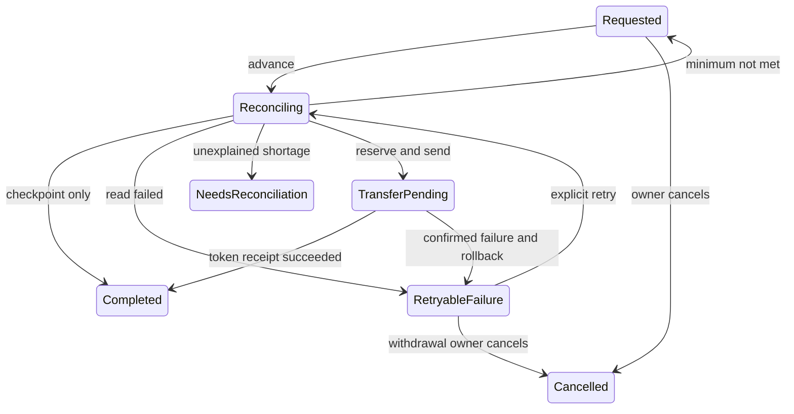

# Idle vault API — milestone 2

Historical baseline. The current revision adds optional immutable `strategy_id`, full strategy settlement and donation methods; see [milestone 3 API](strategy-and-dao.md). `idle_only` is now the mode only when `strategy_id` is null. Use fresh deployments, not milestone 2 state.

Token amounts and operation IDs are JSON strings. Amounts are raw base units. Use account IDs from a verified deployment manifest; no public manifest exists yet.

## Configuration

`new({config})` must be called by the vault account. Deploy and initialize atomically in any future public setup. Config includes `campaign_id`, `token_id`, `token_decimals`, `beneficiary_id`, `guardian_id`, `deposit_cap`, `metadata_hash`, and `disclosure_version`. No setter changes these fields. The mode returned by `get_accounting` is `idle_only`.

## Calls

| Method | Arguments | Access / attached NEAR | Result |
| --- | --- | --- | --- |
| `storage_costs` | `{}` | View | Position/operation charges and advance cost |
| `storage_deposit` | Optional `account_id` | Position cost; excess refunded | Whether a new position was registered |
| `ft_on_transfer` | `sender_id`, `amount`, `msg: "deposit"` | Only configured token | Unused amount; zero means accepted idle capital |
| `request_withdraw` | `units`, `min_amount` | Position owner; operation cost | Monotonic operation ID |
| `cancel_withdraw` | `operation_id` | Request owner; 1 yoctoNEAR | Cancels a requested/retryable withdrawal |
| `advance_operation` | `operation_id` | Permissionless; 1 yoctoNEAR, at least 110 Tgas | Promise result; follow journal and token receipt |
| `request_checkpoint` | `{}` | Guardian; operation cost, at least 110 Tgas | Fixed-token balance reconciliation |
| `set_paused` | `paused` | Guardian predecessor; 1 yoctoNEAR | Stops/resumes new risk; cannot override locks |
| `get_config` | `{}` | View | Immutable configuration |
| `get_position` | `account_id` | View | Nominal, reserved, deposited, withdrawn amounts, or null |
| `get_operation` | `operation_id` | View | Owner, type, stage, version, units, minimum, payout, timestamps, error |
| `get_operations` | `from_id`, `limit` (1–50) | View | Bounded journal page |
| `get_accounting` | `{}` | View | Effective cash/claims, exclusions, outbound reservation, active ID, pause and freshness |

Do not call `ft_on_transfer` from a wallet. Register the user with vault/token and the vault with the token, then invoke the token's `ft_transfer_call` with the vault receiver and `msg: "deposit"`. A successful outer transfer-call can still be a full resolver refund; verify used amount and accepted-deposit event.

## Operation states

A failed/missing final callback leaves `TransferPending` and the global lock. After five minutes the accounting view flags `needs_reconciliation`; time never authorizes another payment. Reads and safe cancellation of separate queued requests remain available. A keeper must not interpret a transaction error as proof that the token transfer failed.

`checkpoint_at` is nanoseconds since epoch: the last authenticated balance observation, not a promise that later activity is included. While `active_operation` is present, accounting is provisional and conflicting priced operations/deposits are blocked.

## Compatibility boundary

No strategy, caller-supplied NAV, allocation, yield donation, DAO proposal or general-purpose cross-contract call appears in this API. Add these with validated receipt and provenance paths. Browser scenario controls and local governance are not this contract API.
