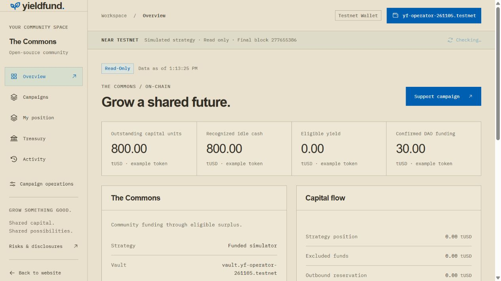
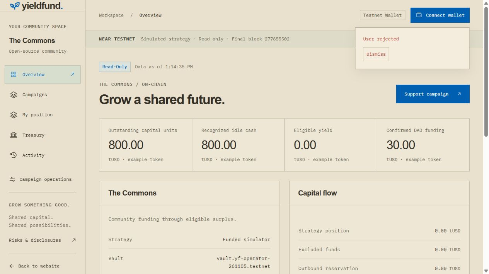

# Milestone 16 — recovery hardening, 14 November 2026

**Implemented and verified locally; approved v2 deployment is in progress.** Public signing remains disabled on the historical deployment. No public transaction occurred during implementation; subsequent approved execution is recorded separately below. [Recovery design](../contracts/recovery-v2.md) and [proposed release](../../deployments/RECOVERY_RELEASE_REVIEW.md) describe the source and pending activation separately.

## Verified behavior

- Atomic test-token payment receipts and cancellation fences allow paid withdrawals/donations to complete once, or proven unexecuted payments to restore reservations once. Late original sends and callbacks cannot pay or settle a newer attempt.
- Durable transfer-call resolver results recover partial allocation/refunds. Simulator recovery handles its lost finalizer without crediting a return twice. Standard NEP-141 methods remain separate; the receipt APIs are explicit test-token extensions.
- Factory progress survives partial child creation, individual registration failure and lost creation/registration callbacks. Recovery preserves initialized keyless children and fixed metadata, protects other unfinished campaigns' native reserves and does not collect another creation deposit.
- UI exposes `Resume setup`, `Resolve payment` and `Resolve allocation` only for the appropriate v2 runtime. Known incomplete creation can permit its exact recovery action; unknown wallet outcomes still block another submission. An original failed receipt can be labelled recovered when fresh on-chain checks prove ready state.
- Metadata hashes bind the selected v1/v2 disclosure. Hosting checks prevent enabling either registry or vault signing without matching v2 manifests and an accepted release record tied to the exact review and finalized transaction hashes.

## Checks completed

| Check | Actual result |
| --- | --- |
| Rust unit tests | 37 passed: accounting 6, factory 10, simulator 1, token 2, vault 18 |
| NEAR Sandbox integration | 17 passed; one explicitly ignored browser-fixture generator |
| TypeScript/tooling suite | 170 passed; one optional live Sandbox adapter test skipped |
| Hosted production build/typecheck | Passed; generated runtime remains read-only |
| Hosting packaging | Four tests passed |

The final contract run used `YIELDFUND_EVIDENCE_DIR=docs/evidence/milestone-16-receipts bash scripts/test-contracts.sh`; [receipt artifacts](milestone-16-receipts/) preserve the local outcomes. Fault-only artifacts exercise missing callbacks/children/registrations, failed and successful outgoing transfers, partial allocation refunds and simulator finalizer recovery. Normal artifacts and their hashes are in the proposed release JSON. Historical milestone receipt files were preserved.

Four release-guard tests cover legacy read-only builds, missing/incomplete acceptance, mismatched manifests and review, mainnet/legacy rejection, and missing/reused receipt hashes. These are controlled validation tests, not proof of actual public wallet acceptance.

## Browser evidence and its limits

Actual HOT Connect / NEAR CLI adapter checks at `http://127.0.0.1:4177/app` connected the existing testnet operator, displayed real historical contract reads, disconnected, and cancelled a subsequent connection request. No transaction handoff, key extraction, signing or broadcast occurred.

Successful transaction signing, transaction rejection, stale account/network review and registry/DAO transaction acceptance still require the fresh v2 deployment and the approved rehearsal. Connection cancellation is not transaction rejection. No acceptance record has been created and no public signing flag changed.

## Release boundary

New token/vault/simulator/factory layouts require fresh accounts. There is no migration for historical vaults, and keyless children cannot be upgraded. The new token journals reserve extra storage and prevent unregistering journal users so sequence fences persist. This is not general recovery for arbitrary NEP-141 assets or a Rhea/Trezu integration.

Pending token resolver evidence, malformed/mismatched proofs, impossible partial returns and unexplained custody shortfalls remain locked. There is no balance-based guess or administrative unlock. The public demo stays read-only until deployment and browser transaction acceptance complete; the user-approved mainnet deferral remains in effect.

The prepared 20-call plan requests four faucet accounts, fresh normal token/factory deployments, two campaigns, funded yield and withdrawal/DAO verification rehearsals. Its exact review hash and fresh read-only preflight are linked from the release review. The user approved that plan with "Approve testnet v2 release". GitHub/Vercel publication was previously authorized, but publishing source alone does not activate signing.

## Approved execution checkpoint

All four faucet accounts are finalized with 10 testnet NEAR each; [account evidence](milestone-16-accounts.json) contains public keys and balances only. Token deployment, 3 NEAR factory funding, factory deployment and Commons creation finalized and passed configuration/authority audits. [Public receipt records](milestone-16-public-receipts/) track execution separately from local Sandbox evidence. The first token transaction was queried again after the verifier learned that RPC deploy ActionView contains the code digest; its exact signed bytes were already checked before the single broadcast. No replacement deployment or duplicate transfer occurred. Wallet acceptance and public activation remain pending.
